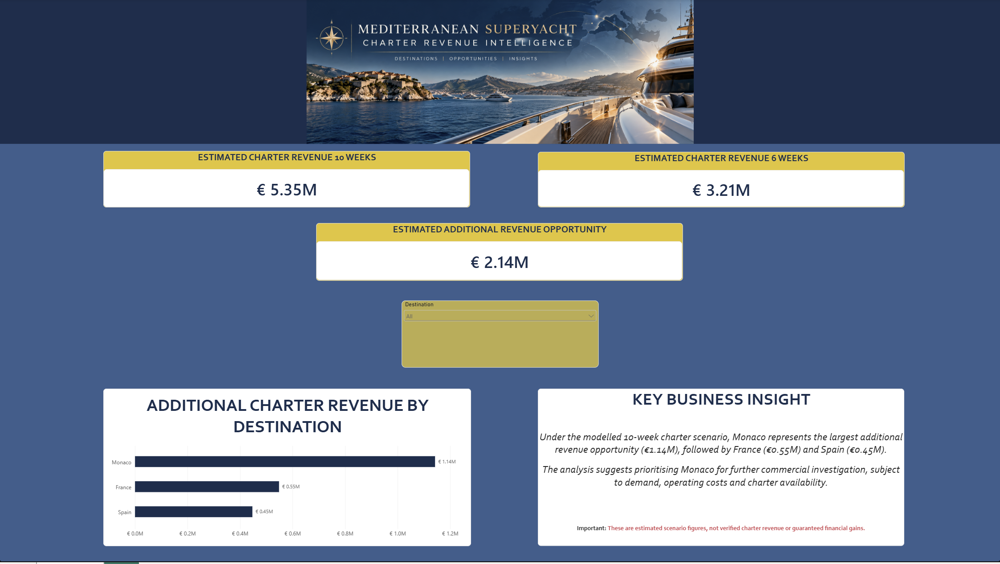

# Mediterranean Superyacht Charter Analytics
### Revenue Intelligence | Python | SQL | KNIME | Power BI

## Project Overview

This project demonstrates how data analytics can support commercial decision-making within the Mediterranean superyacht charter industry.

Using Python, SQL, KNIME and Microsoft Power BI, I developed an analytical workflow to explore charter pricing, seasonal revenue opportunities and destination performance.

The objective was to identify potential revenue opportunities and communicate actionable business insights through an interactive dashboard.

## Business Problem

Superyacht charter operators face several commercial challenges:

- Seasonal fluctuations in charter demand
- Different charter pricing across Mediterranean destinations
- Revenue lost through unbooked charter weeks
- Difficulty comparing potential revenue opportunities

This project explores how data-driven analysis can help operators evaluate commercial opportunities and improve revenue planning.

## Technology Stack

| Technology | Application |
|---|---|
| Python | Data processing and analysis |
| SQL / SQLite | Data querying and financial calculations |
| KNIME | Data transformation, filtering and workflow automation |
| Power BI | Interactive dashboards and business intelligence |
| CSV | Data storage and integration |
| GitHub | Project documentation and version control |

## Analytical Workflow

1. Prepare charter pricing and destination datasets.
2. Analyse seasonal pricing using Python.
3. Perform SQL queries and revenue calculations.
4. Transform and filter datasets using KNIME.
5. Export prepared datasets for Power BI.
6. Build a dashboard presenting financial scenarios and destination opportunities.
7. Translate analytical findings into commercial recommendations.

## Power BI Dashboard

## Key Financial Insights

The dashboard compares two illustrative charter revenue scenarios.

| Financial Metric | Estimated Revenue |
|---|---:|
| 10-week charter scenario | €5.35 million |
| 6-week charter scenario | €3.21 million |
| Additional revenue opportunity | €2.14 million |

The model suggests that increasing charter utilisation from six to ten weeks could generate an additional €2.14 million in gross charter revenue under the assumed pricing conditions.

These figures are scenario-based estimates, not verified financial results or guaranteed revenue.

## Destination Analysis

The analysis examines additional charter revenue opportunities across three Mediterranean destinations:

- Monaco
- France
- Spain

Under the modelled assumptions, Monaco represents the largest additional revenue opportunity.

Further commercial investigation would be required to evaluate actual demand, operational costs, vessel availability and profitability.

## Business Recommendations

Based on the analytical findings:

1. Investigate opportunities to improve charter utilisation.
2. Compare destination pricing and seasonal revenue potential.
3. Evaluate Monaco as a priority market for further commercial analysis.
4. Incorporate operating costs before making profitability decisions.
5. Use business intelligence dashboards to support ongoing revenue planning.

## Project Deliverables

This repository includes:

- Python analysis scripts
- SQL analysis implemented in Python
- KNIME analytical workflow
- Processed CSV datasets
- Power BI dashboard file
- Dashboard preview image
- Project documentation

## Limitations

This is a portfolio project using illustrative financial scenarios.

The results should not be interpreted as actual charter operator performance, validated market forecasts or guaranteed commercial outcomes.

Additional real-world operational and booking data would be required before implementing business recommendations.

## Conclusion

This project demonstrates the application of Python, SQL, KNIME and Power BI to a maritime business problem.

It combines technical data analysis with commercial reasoning, financial scenario modelling and business intelligence reporting.

The objective is to demonstrate how analytical tools can turn structured data into insights that support business decisions.
